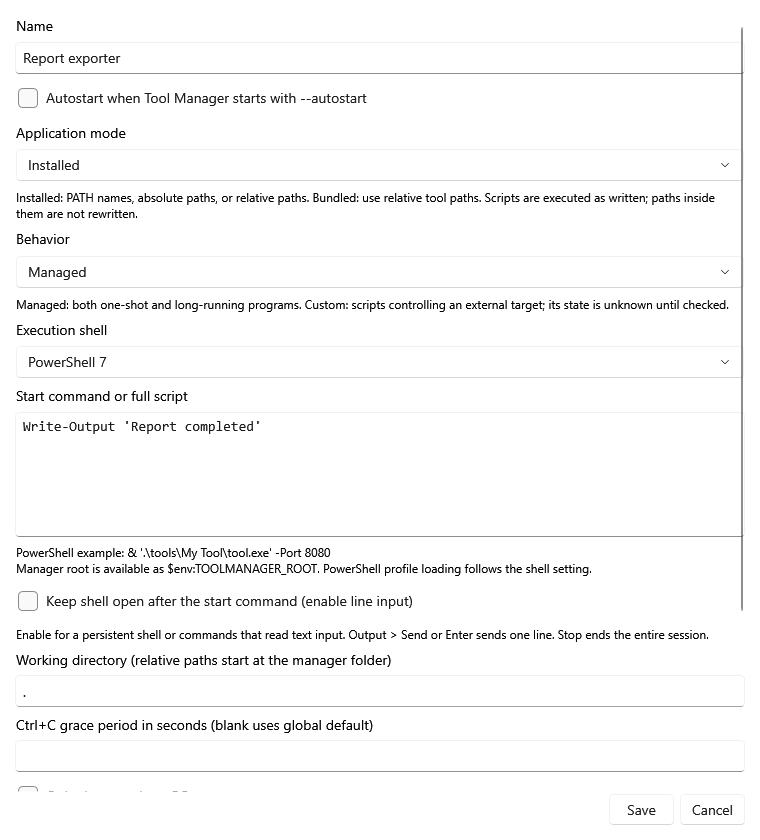

<p align="center">
  
</p>

# Tool Manager

A portable Windows tray app for the commands, scripts and utilities you use every day. Launch a tool, stop it gracefully and inspect its output from one place.

**Windows x64** · **.NET 10 + WPF** · **PowerShell 7 / Windows PowerShell / CMD**

[Quick start](#quick-start) · [Screenshots](#screenshots) · [Configure a tool](#configure-a-tool) · [Build and run](#build-and-run) · [Technical reference](#technical-reference)

## At a glance

| Bring your tools | Stay in control | Take it with you |
| --- | --- | --- |
| Run installed commands or bundle tools alongside the app. | Separate Start and Stop buttons, graceful Ctrl+C and captured output. | Keep configuration beside the executable and choose which PCs show each tool. |
| Use multiline scripts and reusable shell profiles. | Review run history or send line input to a shell kept open. | No installer or service. Optional startup at sign-in. |

## Quick start

1. Extract a release into a **fresh, writable folder**. Choose the self-contained Windows x64 package to include the .NET runtime.
2. Open `ToolManager.exe`, then **Settings > Add** to create your first tool.
3. Choose a shell and enter a command, for example `Write-Output 'Hello from Tool Manager'` for PowerShell.
4. Save, click **Start**, then open **Output** to see the result.

Closing the main window hides it in the notification area. Click the tray icon to reopen it, or use **Exit manager** to stop active sessions and quit. Windows may put the icon in the tray overflow area.

> **Shells are separate.** The default is `pwsh.exe` (PowerShell 7). Install it separately or select Windows PowerShell or CMD in Settings. The app does not silently switch shells.

## Screenshots

Actual WPF interface renders from the production-build UI fixture, captured on 19 November 2026. Tool names, status and output are sample data, not live tool activity. Captures show window content without Windows title bars.

### Your tools, one view


<details>
<summary>Configure once, run again - view the tool editor</summary>

Set the command, execution shell, working directory and shutdown behavior for each tool.



</details>

<details>
<summary>See what happened - view captured output</summary>

Inspect output, exit code and duration, copy the text or follow a running session.


</details>

## Build and run

Requires Windows and the **.NET 10 SDK**. Run from PowerShell:

```powershell
.\Build.ps1 -Test -Publish
.\outputs\ToolManager\ToolManager.exe
```

| Package | Build command | Output folder | Target PC needs |
| --- | --- | --- | --- |
| Self-contained | `.\Build.ps1 -Publish` | `outputs/ToolManager` | Windows x64; .NET included |
| Framework-dependent | `.\Build.ps1 -Publish -FrameworkDependent` | `outputs/ToolManager-framework-dependent` | Windows x64 and .NET 10 Windows Desktop Runtime (x64) |

Both variants bundle the app into a single executable. The self-contained bundle is compressed. Native libraries extract to the .NET bundle cache at runtime; debug symbols are excluded and framework languages are retained.

Copy the whole portable folder, including your tools and configuration, when moving to another PC. Close a running distribution before updating it. Local builds preserve `tools.json`, its backup and user data; missing configuration is recovered from `tools.json.bak` when available.

For a consistent launch from the repository, use `Start-ToolManager.ps1`. To work on the app in isolation:

```powershell
.\Build.ps1
.\Start-ToolManager.ps1 -Development
```

Development builds, including ordinary Release builds, show **DEV** in titles, tray text, icons and scheduled task names. Source-tree executables under `src/ToolManager/bin` or `work/build` use `outputs/ToolManager-dev` for separate settings when the source project is present. Published and distributed builds use their own portable folder; published builds have no DEV markers. Each configuration root has its own instance lock.

Production settings and tools are not copied into development automatically. Both copies can run together, but their tools can still contend for ports and other resources.

## Configure a tool

Settings includes Show configuration in File Explorer to select tools.json for copying or manual edits. Save in Settings can overwrite manual edits made while the dialog is open. Settings supports adding, editing, deleting and ordering tools, as well as adding/editing shell profiles and choosing defaults. If runs are active, Settings offers Stop and continue, waits for all managed sessions to finish, then opens configuration. Cancel leaves the runs active. External targets controlled by Custom scripts are not stopped automatically.

- Managed: use for both one-shot commands and long-running tools. Start creates a run; Stop sends Ctrl+C and waits for the configured timeout, then forcibly terminates remaining processes owned by that run. Only one active run per entry is allowed.
- Custom: start and stop scripts control a target outside the manager's process session, such as a service. Optional Check script uses exit code 0 for running, 1 for stopped, and other values for unknown. No checks run automatically. Canceling an active script stops that script's session, not its external target. External targets are not automatically stopped on manager exit.
- Installed: commands can use PATH names, absolute paths or relative paths.
- Bundled: use relative tool paths. The working-directory setting must be relative. Arbitrary script contents are executed as entered, not parsed or rewritten to enforce portability.

### Shells and scripts

Shell profiles accept an executable name found in PATH, an absolute path, or a path relative to the manager folder. Default is pwsh.exe. Windows PowerShell and CMD profiles are supplied. There is no silent shell fallback. The portable manager includes .NET, not PowerShell 7 or your tools' other dependencies. A bundled shell can be selected by a relative executable path.

PowerShell profiles are loaded by default, including for existing shell configurations. Disable Load PowerShell profiles in Settings > shell profiles > Edit shell when you want an isolated environment. Script execution policy is respected. Scripts run with your user privileges. Enter commands, cmdlets, .ps1 calls with parameters, or full multiline scripts. CMD profiles interpret CMD syntax.

```powershell
& '.\tools\My Tool\tool.exe' --port 8080
& '.\scripts\Export.ps1' -Destination '.\exports'
Get-ChildItem '.\input' | ForEach-Object { Write-Output $_.Name }
& "$env:TOOLMANAGER_ROOT\tools\tool.exe"
```

### Paths and working directories

All relative working-directory settings resolve from the manager folder, not the folder used to launch it. Relative paths inside a script resolve from that run's working directory. TOOLMANAGER_ROOT always contains the manager folder. PowerShell does not automatically execute files from the working directory: use .\tool.exe or the call operator for quoted paths. Scripts should use explicit exit codes where appropriate; the manager reports the shell's exit code.

### Start and Stop states

The main view always shows separate Start and Stop buttons. Start is enabled while idle; Stop is enabled while running, including an external Custom target reported as running by Check. Both are disabled while stopping. An unknown Custom status leaves Start enabled and Stop disabled.

## Start with Windows

Settings > Startup provides Add startup task, Remove startup task and Reset. The task passes --autostart --hidden: opted-in tools start while the manager stays in the tray. Use Reset to update an existing task. Running ToolManager.exe --hidden also starts without showing a window, independently of --autostart. Start-ToolManager.ps1 supports -Hidden and -Autostart. Add is enabled only when this copy's task is absent; Remove is enabled only when it exists. Status refreshes when Settings opens or regains focus. If Task Scheduler cannot be read, both buttons remain disabled and an error is shown.

The task starts the currently running executable when the current user signs in, including after Windows startup. A tray application requires an interactive desktop, so it uses a user-specific logon trigger rather than a pre-login boot trigger. No password is stored, the manager runs with normal user privileges, battery power does not prevent startup, and no execution time limit is imposed. Windows requests administrator permission only when adding or removing fails with access denied. Canceling that prompt leaves the task unchanged. Changes apply immediately, independently of Save or Cancel.

Tasks are local to the PC and identified by user SID and executable path. Separate portable copies have separate tasks. Remove the task before moving or deleting its executable, then add it again from the new location.

## Output and lifecycle

Output opens a separate window with the current and retained previous runs, stdout, marked stderr, duration, exit code, Copy, and Follow output. The output and input panes have a fixed black background, including while hovered or focused. PowerShell color formatting is disabled where supported, and ANSI/OSC terminal escapes are filtered incrementally from both output streams, including sequences split across pipe reads. Terminal cursor controls and interactive TUI applications are not emulated. Separate stdout/stderr streams cannot guarantee exact combined ordering. UTF-8 is configured for supplied shells; legacy executables with different encodings may display incorrectly.

### Run history

History is in memory only, cleared on exit. Defaults: last 10 completed runs per entry, 2 MiB of UTF-16 text per run, and 64 MiB total retained text. Limits bound stored text, not total application memory or temporary UI copies. Old output is discarded with a visible marker. Closing an output window does not stop its run.

### Send input to a running shell

Enable Keep shell open after the start command in a Managed tool to send line input from its Output window. PowerShell uses -NoExit and CMD uses /k; Send or Enter sends a single UTF-8 line (up to 4096 characters) to the same live session. Variables persist across commands and Read-Host accepts text responses. Select the active run, not a previous run. Use exit to finish or Stop to end the session with Ctrl+C and the configured timeout. Input is not evaluated by the manager: it goes to whichever program currently reads the session input. No terminal emulation, tab completion or secure-input UI is provided. Keep-open mode is off for existing tools.

### Shutdown and process ownership

Each run has an isolated hidden Windows console and a Windows Job Object. Ctrl+C is a real console event, not an input character. A cooperating program can perform cleanup before exiting. An ignoring program and its ordinary child processes are terminated after the grace period. Running means processes exist, not that the tool is ready. Stop during startup is queued. Exit manager stops all active sessions using the same sequence.

The runner starts with a hidden window setting so its console is hidden when allocated, avoiding the brief popup caused by creating a visible console and hiding it afterward. This applies to the manager's console; tools that explicitly create their own windows control those windows themselves.

Detached consoles, services, elevated processes and other processes created outside the job may require Custom commands. Processes ignoring Ctrl+C are subject to forced termination. A manager crash closes its runner connection; the runner attempts graceful shutdown. If a runner crashes, the job closes and its processes are terminated immediately.

## PC visibility and storage

Enable Only show on these PCs to autofill the current name. Add this PC appends it distinctly; manual names use one line each. Matching ignores case and surrounding whitespace. An empty restricted list hides the entry everywhere. Settings still shows hidden entries on every PC. This is filtering, not access control.

- tools.json: shared configuration next to the executable.
- tools.json.bak: previous configuration after an atomic replacement.
- Windows temporary folder, ToolManager/runs/RUN-ID/: temporary scripts and execution requests, removed after completion where possible. Interrupted runs may leave files here.

Configuration and scripts can contain sensitive values. Configuration stays in the portable root. Per-run scripts and requests use the current user's Windows temporary folder so sync clients do not upload run traffic. Use a writable folder. Sharing/synchronizing the same configuration is supported for reading on multiple PCs; simultaneous editing is not coordinated. Keep separate copies or avoid simultaneous saves.

## Technical reference

<details>
<summary>Tray placement and portable build details</summary>

The popup uses the tray click location to select its monitor and reads actual primary/secondary taskbar bounds, including moved taskbars. It opens beside the corresponding edge within the monitor work area. Per-monitor DPI scaling and negative coordinates are supported. If a custom shell provides no usable taskbar window, placement falls back to the clicked edge and reported work area.

The build script backs up settings, builds and tests under `work/build`, publishes to a staging directory and copies application files and README imagery into the output folder. Configuration, backups and user data are never copied from a build or deleted. No installer, service, registry changes or web server is used. Optional startup uses a local scheduled task.

</details>

<details>
<summary>Release workflow and approval setup</summary>

After `.github/workflows/release.yml` is on the repository's default branch, open **Actions > Build and release > Run workflow**. Select the branch to build and enter a new version tag such as `v1.0.0`. The workflow runs only when manually started.

One-time setup: open **Settings > Environments**, create an environment named **release**, and enable **Required reviewers** with your GitHub account as a reviewer. Leave **Prevent self-review** off if you want to approve runs you started. Disable administrator bypass if approval must always be required. These settings are stored in GitHub, not in the workflow YAML. Without a required reviewer, the workflow refuses publication after uploading the candidate.

The **Build downloadable candidate** job installs the .NET 10 SDK and runs `Build.ps1 -Test -Publish`. After the build and checks pass, it publishes both single-file variants and uploads both Windows x64 ZIPs as one Actions artifact retained for 30 days, subject to repository retention limits. No tag or release is created by this job. Use the download link in the job summary or the run's **Artifacts** section. Extract the downloaded artifact archive, then extract `ToolManager-v1.0.0-win-x64.zip` and run `ToolManager/ToolManager.exe`. Alternatively, extract `ToolManager-v1.0.0-win-x64-framework-dependent.zip` and run `ToolManager-framework-dependent/ToolManager.exe` on a PC with the required Desktop Runtime. Each package contains the executable, README and its image assets plus empty tools/scripts folders. The summary records the source commit and both ZIP checksums.

The **Publish approved candidate** job waits for approval of the **release** environment. Download and test the candidate, then use **Review deployments** on the workflow run to approve publication, or reject it to stop. On approval, the job downloads the exact artifact by ID, verifies both SHA256 checksums, and creates a published GitHub release with generated notes and both original ZIPs, without rebuilding. The new tag points to the exact source commit of the run, even if the branch has advanced. Existing tags are rejected both before building and immediately before publication. The executable's version is taken from the tag without the `v` prefix. If the artifact has expired or was deleted, publication fails. Re-running the build creates a new candidate that needs to be tested again.

Only the approval-gated publication job has `contents: write` on the built-in `GITHUB_TOKEN`; the build job has read-only repository access. No additional secret is required. Repository or organization policy must allow GitHub Actions and these permissions. Packages contain application files, the README and its image assets, without local settings, user data, or bundled user tools.

Decision4 class: Repair. Boundary map gap: no project boundary map was supplied. Chose two jobs in one workflow with an environment approval gate over two manual workflows because this keeps candidate review and publication in the same run. Commits us to maintaining required reviewers on the release environment, a Windows runner, and creating a new version tag for each release. The existing build script keeps release and local checks consistent. Chose two single-file variants over AOT or framework migration because WPF requires the managed runtime. Commits us to testing both bundles and documenting the Desktop Runtime prerequisite for the framework-dependent variant.

</details>

<details>
<summary>Process checks and their scope</summary>

Build.ps1 -Test runs actual pwsh.exe, powershell.exe, CMD and a dedicated console fixture. It checks scripts and parameters, output and exit codes, real Ctrl+C, timeout enforcement, owned children, duplicate prevention, retention, PC filtering, config backup, missing dependencies and cleanup. These are local process tests, not validation of your own tools or of a clean PC.

</details>

<details>
<summary>Code style and editor setup</summary>

ToolManager.slnx stays at the repository root and contains the WPF application in src/ToolManager and its console test fixture in tests. Application files are grouped into Models, Execution, Interop, Persistence, Startup, UI (including Placement), and Diagnostics. Namespaces follow the project name and relative folder path, for example ToolManager.UI.Placement. Program.cs and GlobalUsings.cs remain at the application project root; embedded assets and the application manifest stay with the project. The SDK discovers C# source files recursively using its default compile items. VS Code is configured to load this solution and to avoid treating UI files or backup sources as standalone console applications. The application uses the Windows Desktop reference pack through UseWPF; do not add runtime WindowsBase.dll references manually.

StyleCop.Analyzers 1.3.180 uses its default rules. Documentation rules and the corresponding disabled-documentation notice are excluded. Analyzer warnings fail the build. Each top-level type has its own file, object initializers and control flow use readable multiline layouts, and native handle ownership remains local to ConsoleSession.

```powershell
dotnet restore ToolManager.slnx
dotnet format ToolManager.slnx --no-restore
dotnet format ToolManager.slnx --no-restore --verify-no-changes
.\Build.ps1 -Test -Publish
```

The clean-code review removed unused notification events, separated request preparation and cleanup from run monitoring, made native handle disposal idempotent, guaranteed active-run finalization even if cleanup fails, validated null configuration entries, and handled invalid helper startup arguments without a desktop crash dialog. Configuration property names and the portable settings location remain unchanged.

For this cleanup, chose focused lifecycle methods over new application layers because the identified problems were contained in ownership and error paths. This commits the UI to its existing WPF code-behind structure and keeps process behavior covered by real-process checks.

For the main-view button change, Decision4 class: Repair. Boundary map gap: no project boundary map was supplied. Chose separate fixed Start and Stop buttons over a shared toggle because a second click must not reverse the first action. Commits us to enabling Stop only for an active run or a Custom target reported as running.

</details>

<details>
<summary>Implementation decisions</summary>

Decision4 class: Repair. Boundary map gap: no project boundary map was supplied. Chose WPF and a small per-run helper over WinUI 3 and a persistent service because this is a portable Windows utility. Commits us to Windows, native console/job interop, and validating shutdown with real processes. The .NET 10 Fluent theme selection API is marked experimental by WPF; the suppression is limited to that selection.

</details>

<details>
<summary>Issue fixes and choices</summary>

Issues #1-#7 are implemented locally. Decision4 class: Repair. Boundary map gap: no project boundary map was supplied. Chose separate development identity and configuration over sharing production settings because parallel testing must not edit production configuration. Commits us to configuring development tools separately and testing both development and published builds. Chose background request preparation and process launch over moving manager state to worker threads because WPF and lifecycle state keep their existing single-thread ownership. Commits us to preserving that ownership for later execution changes. Chose Windows temporary run directories over synchronized portable data because scripts and requests are short-lived execution inputs. Commits us to best-effort cleanup; interrupted runs can leave temporary files. Existing portable data is left untouched. Chose primary taskbar placement for initial opening and tray-click placement thereafter over cursor-only startup because launch cursor position does not identify the notification area.

</details>

<details>
<summary>Startup and console design choices</summary>

Decision4 class: Repair. Map gap: no boundary map was supplied for startup integration. Chose an interactive per-user logon task over a boot task because the tray icon needs the user's desktop. Commits us to a local path-bound task that must be removed and recreated when the executable moves.

For console startup visibility, Decision4 class: Repair. Boundary map gap: no project boundary map was supplied. Chose the runner's hidden startup setting over hiding the console after allocation because hiding afterward permits a visible flash. Commits us to retaining a real console for Ctrl+C and checking hidden console visibility with the real-process fixture.

</details>
