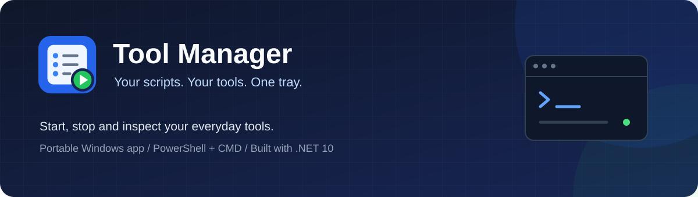
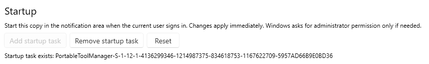
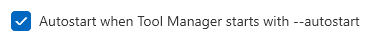
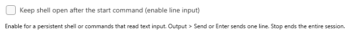
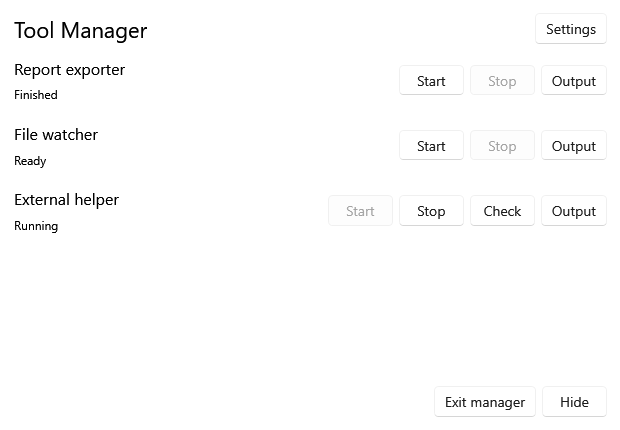
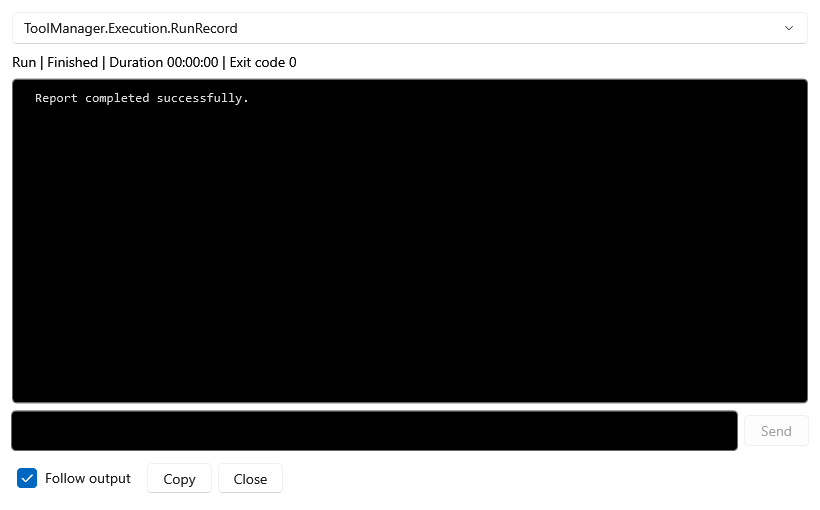

  

# Tool Manager

Keep the commands, scripts and apps you use every day in the Windows tray. Set them up once, sync the folder between PCs, and choose what runs on each one.

[Download](https://github.com/SeidChr/ToolManager/releases) | [Quick start](#quick-start) | [Screenshots](#screenshots) | [User guide](docs/usage.md)

## Take your tools from PC to PC

Put the Tool Manager folder in OneDrive or another synced folder. The executable, settings and any tools you bundle can travel together. Each PC can keep the folder in a different location.

- **Bring the tools with you.** Put executables in `tools` and scripts in `scripts`. Set the working directory to the Tool Manager folder and use relative paths such as `.\tools\my-tool.exe`.
- **Show each tool where it belongs.** In the tool editor, turn on **Only show on these PCs** and select the PCs that should see it. For example, keep a local server on your workstation while showing shared scripts on both your workstation and laptop.

Let changes sync before editing settings on another PC. Each PC still needs any dependencies you keep outside the synced folder.

## Run the commands you already use

Paste a command or a multiline script into a tool entry and pick the shell it uses. Tool Manager supports **PowerShell 7**, **Windows PowerShell** and **CMD**. A tool can be a single command, a script that takes arguments or an app that opens its own window.

| Try this | What it runs |
| --- | --- |
| `Start-Sleep -Seconds 5` | A PowerShell command |
| `dotnet run sample.cs` | A C# file using the .NET 10 SDK |
| `notepad.exe` | A Windows app with its own window |

Use the shell and dependencies you would use for the same command in a console. Apps that depend on a full interactive terminal still need one.

## Start your tools when you sign in

In **Settings > Startup**, choose **Add startup task**. Then enable **Autostart** for the tools you want Windows to launch at sign-in. Tool Manager stays in the tray and starts only the opted-in tools visible on that PC.

Select **Start autostart tools** next to **Settings** to start the idle autostart tools visible on the current PC at any time.

Set up the startup task once on each PC where you want it. If you move the folder, remove the task before moving it and add it again from the new location.

## Control a tool that's already running

Use **Custom** mode for things like a Windows service or a background helper that runs independently of Tool Manager. Give it separate **Start** and **Stop** scripts. Add an optional **Check** script so you can check the target's status from the tray.

## Keep a shell open for follow-up commands

Turn on **Keep shell open after the start command** for a Managed tool. Open **Output**, select the active run and send another command or answer a text prompt. Each line goes to the same session, so you can reuse variables you set earlier.

## Quick start

1. Download the self-contained Windows x64 ZIP and extract it to a writable folder. The smaller framework-dependent ZIP requires the .NET 10 Windows Desktop Runtime (x64).
2. Open `ToolManager.exe` and choose **Settings > Add**.
3. Select **Windows PowerShell** and enter `Write-Output 'Hello from Tool Manager'`. If you have PowerShell 7, you can use the default shell profile.
4. Save the tool, select **Start**, and open **Output** to see the result.

Closing the window hides it. Use the Tool Manager icon in the notification area to reopen it.

## Screenshots

The app with sample tools and output.

Tool editor and output window

## Guides

- [Using Tool Manager](docs/usage.md) covers configuration, startup, run history and troubleshooting details.
- [Building and maintaining Tool Manager](docs/development.md) covers local development, tests and releases.
